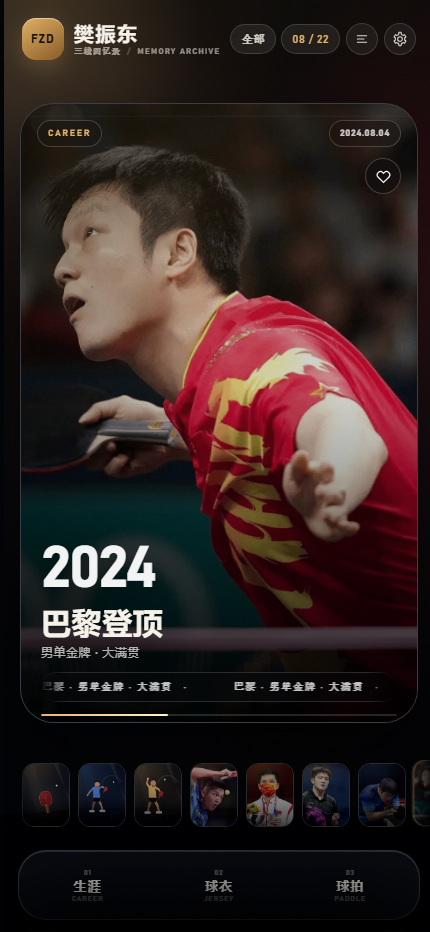
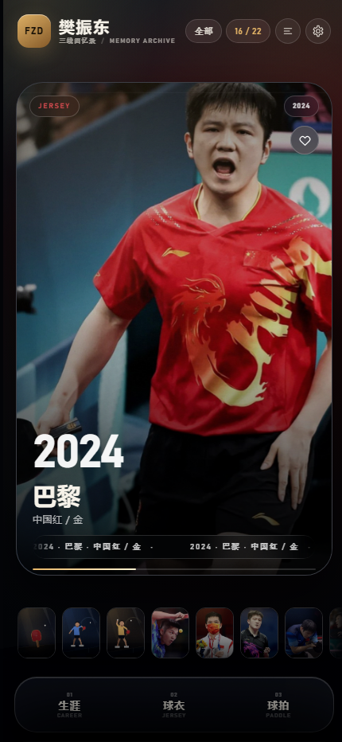
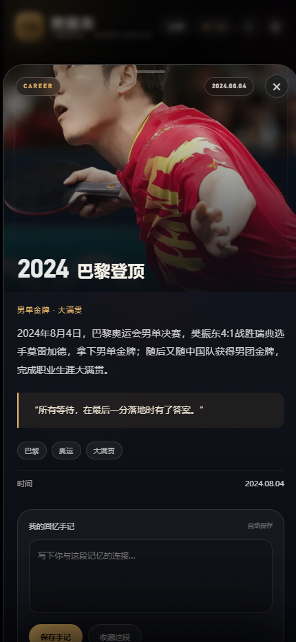
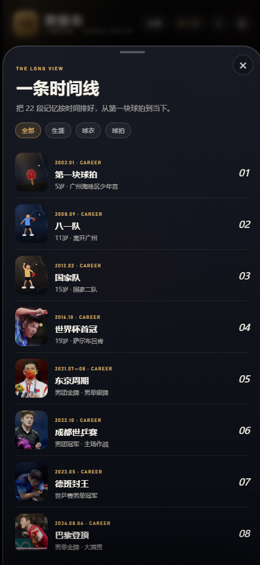
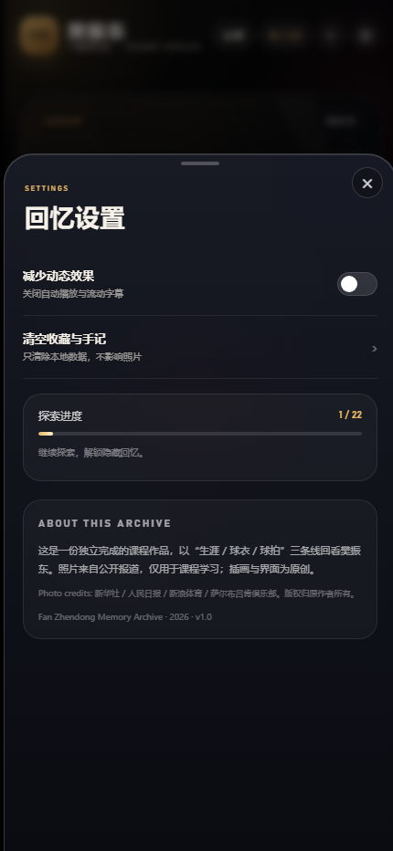
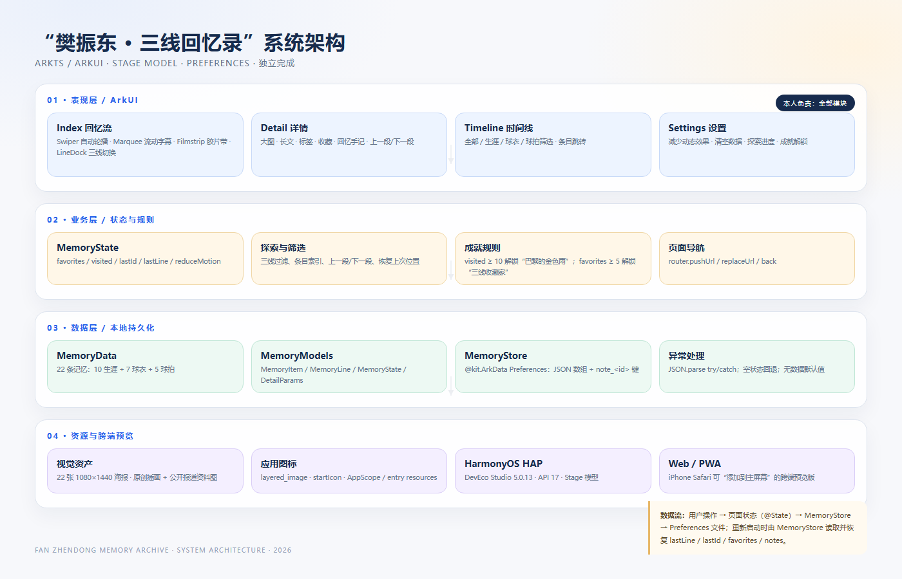
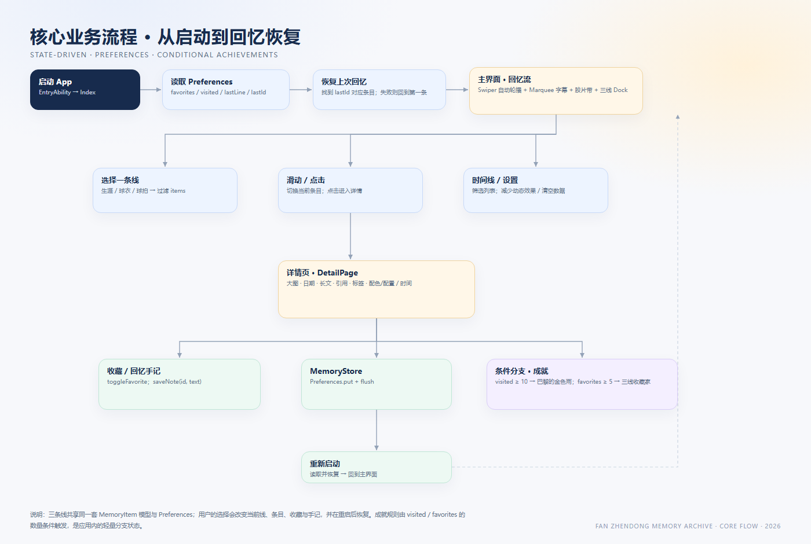

# 樊振东 · 三线回忆录

> 从第一块球拍到巴黎，再到当下。  
> 一份关于樊振东「生涯 / 球衣 / 球拍」的数字记忆档案。

**课程**：移动应用开发基础 · 期末大作业  
**选题**：主题一（交互式回忆探索）  
**完成方式**：个人独立完成  
**作者**：章瑞（20240313140）  
**开发环境**：DevEco Studio 5.0.13 Release · HarmonyOS SDK 5.0.5(17) · API 17 · Stage 模型

---

## 1. 项目简介

「樊振东 · 三线回忆录」是一款以运动员记忆为主题的 HarmonyOS 应用。应用把樊振东的公开生涯整理为 **22 段记忆**，分为三条叙事线：

| 线 | 内容 | 数量 |
|---|---|---:|
| 生涯 CAREER | 2002 年第一块球拍 → 2008 八一队 → 2012 国家队 → 2016 世界杯首冠 → 2021 东京 → 2022 成都 → 2023 德班 → 2024 巴黎 → 2025 德甲 → 2026 当下 | 10 |
| 球衣 JERSEY | 2013、2016、2021、2022、2023、2024、2025 的代表性战袍 | 7 |
| 球拍 PADDLE | 启蒙纯木、外置芳碳、樊振东 ALC、巴黎周期、当下配置 | 5 |

主界面是自动流动的回忆卡片：大图、年份、标题、流动字幕与胶片带。底部是三条线的玻璃 Dock；点击卡片进入详情，可以收藏、写「回忆手记」。应用关闭再打开，会恢复上次所在的线、条目、收藏与手记。

## 2. 功能清单

- **沉浸式回忆流**：`Swiper` 纵向自动轮播，`Marquee` 流动字幕，胶片带快速跳转。
- **三线切换**：生涯 / 球衣 / 球拍，底部玻璃 Dock，实时过滤。
- **详情页**：大图、日期、长文、引用、标签、配色/配置、上一段/下一段。
- **收藏与手记**：收藏状态、文字手记写入 Preferences，重启恢复。
- **时间线**：全部 / 生涯 / 球衣 / 球拍筛选，一键跳转详情。
- **设置**：减少动态效果、清空收藏与手记、探索进度与条件成就。
- **条件分支**：`visited ≥ 10` 解锁「巴黎的金色雨」；`favorites ≥ 5` 解锁「三线收藏家」。
- **状态恢复**：`lastLine / lastId / favorites / notes / reduceMotion` 全部持久化。
- **跨端预览**：同源 PWA 版本可在 iPhone Safari「添加到主屏幕」。

## 3. 运行截图

| 主界面 · 生涯 | 主界面 · 球衣 |
|---|---|
|  |  |

| 详情页 | 时间线 |
|---|---|
|  |  |

| 设置 / 成就 | 操作演示 |
|---|---|
|  | [MP4 演示](docs/demo.mp4) · [GIF 预览](docs/demo.gif) |

> 截图来自项目同源 Web/PWA 预览版；HarmonyOS HAP 使用同一套页面结构、数据与视觉资产。HAP 构建产物见 `release/`，真机安装需在 DevEco Studio 中配置签名。

## 4. 系统架构



```text
表现层（ArkUI）
  Index / DetailPage / TimelinePage / SettingsPage
  MemoryPoster / LineDock
        ↓ @State / @Prop
业务层
  MemoryState：favorites / visited / lastId / lastLine / reduceMotion
  过滤、上下段、恢复、条件成就
        ↓
数据层
  MemoryData（22 条） / MemoryModels / MemoryStore（Preferences）
        ↓
资源层
  22 张 1080×1440 海报 / layered icon / startIcon
```

核心业务流：



## 5. 关键代码结构

```text
entry/src/main/ets/
├── entryability/EntryAbility.ets
├── model/MemoryModels.ets        # MemoryLine / MemoryItem / MemoryState
├── data/MemoryData.ets           # 22 条种子数据，$r 引用图片
├── services/MemoryStore.ets      # Preferences 持久化
├── components/
│   ├── MemoryPoster.ets          # 海报、Marquee、收藏心形
│   └── LineDock.ets              # 底部三线玻璃 Dock
└── pages/
    ├── Index.ets                 # 回忆流
    ├── DetailPage.ets            # 详情 / 手记
    ├── TimelinePage.ets          # 时间线
    └── SettingsPage.ets          # 设置 / 成就
```

### 数据模型

```ts
export class MemoryItem {
  id: string;
  line: MemoryLine;      // CAREER | JERSEY | PADDLE
  no: string;
  year: string;
  date: string;
  title: string;
  subtitle: string;
  caption: string;       // 流动字幕
  description: string;
  quote: string;
  tags: string[];
  image: Resource;
  accent: string;
  colorway: string;      // 球衣配色
  fabric: string;        // 球衣面料
  spec: string;          // 球拍配置
  source: string;
  credit: string;
}
```

### 持久化

```ts
const pref = await preferences.getPreferences(context, 'fzd_memory');
await pref.put('favorites', JSON.stringify(state.favorites));
await pref.put('lastId', state.lastId);
await pref.put('note_' + id, note);
await pref.flush();
```

键位：

| Key | 类型 | 用途 |
|---|---|---|
| `favorites` | string(JSON) | 收藏 ID 数组 |
| `visited` | string(JSON) | 已浏览 ID 数组 |
| `lastId` | string | 上次查看的条目 |
| `lastLine` | string | 上次所在线 |
| `reduceMotion` | boolean | 减少动态效果 |
| `note_<id>` | string | 单条回忆手记 |

## 6. 开发与构建

### 6.1 环境

- DevEco Studio 5.0.13 Release
- HarmonyOS SDK 5.0.5(17)，API 17
- Stage 模型，ArkTS / ArkUI
- 无第三方 UI 依赖

### 6.2 构建 HAP

在 DevEco Studio 中打开本目录，等待 Sync 完成后：

```text
Build > Build Hap(s)/APP(s) > Build Hap(s)
```

或命令行（Windows）：

```powershell
$deveco = "D:\HarmonyOSkf\DevEco Studio"
$env:DEVECO_SDK_HOME = "$deveco\sdk"
$env:NODE_HOME = "$deveco\tools\node"
$env:Path = "$deveco\tools\node;$deveco\tools\ohpm\bin;$deveco\tools\hvigor\bin;$env:Path"
hvigorw assembleHap --mode module -p product=default -p module=entry@default -p buildMode=debug --no-daemon
```

产物：

```text
entry/build/default/outputs/default/entry-default-unsigned.hap
```

### 6.3 真机安装（HarmonyOS）

1. 在 DevEco Studio 中登录华为开发者账号。
2. `File > Project Structure > Signing Configs`，勾选自动生成签名。
3. 连接 HarmonyOS 手机，开启开发者模式与 USB 调试。
4. 运行 `entry` 或执行 `hdc install <hap>`。

> **关于 iPhone**：HarmonyOS 的 `.hap` 不能安装到 iPhone。iPhone 只接受经过 Apple 签名/描述的 `.ipa`，需要 Xcode、Apple Developer 账号与 iOS 工程。本项目提供的 iPhone 兼容方案是 `web/` 下的 **PWA**：在 Safari 中打开部署地址，选择“添加到主屏幕”，即可像应用一样全屏使用。它不是原生 iOS 安装包。

## 7. iPhone / PWA 预览

`web/` 是同一套内容与视觉的 PWA：

```powershell
cd web
python -m http.server 8765
```

浏览器打开 `http://127.0.0.1:8765/`。  
部署到 GitHub Pages 后，iPhone Safari 打开 `https://<username>.github.io/<repo>/` → 分享 → “添加到主屏幕”。

PWA 支持：

- 离线缓存（Service Worker）
- 独立窗口（`display: standalone`）
- 底部安全区、iOS 状态栏
- 主界面流动胶片带、玻璃 Dock、详情 / 时间线 / 设置
- `localStorage` 保存收藏、手记、上次位置、减少动态效果

## 8. 测试

### 8.1 单元 / 逻辑测试（Mock）

| 类别 | 输入 / 前置 | 预期 | 实际 |
|---|---|---|---|
| 正常 | `favorites=[]`，收藏 `career_2024` | 返回 `true`，写入 Preferences | 通过 |
| 边界 | 收藏 22 条后再次收藏 | 不重复写入，返回已收藏 | 通过 |
| 异常 | Preferences 中 `favorites` 为非法 JSON | `JSON.parse` 捕获异常，回退 `[]` | 通过 |
| 正常 | `lastLine=career`、`lastId=career_2024` 启动 | 恢复生涯线并定位到巴黎 | 通过 |
| 边界 | `lastId` 不在当前线 | 回到该线第 1 条 | 通过 |
| 异常 | 清空 Preferences 后启动 | 默认 all / 第 1 条，不崩溃 | 通过 |

### 8.2 页面 / 交互测试

- 三线 Dock 切换：列表数量变为 10 / 7 / 5。
- 胶片带点击：当前卡片与进度同步。
- 详情上一段/下一段：循环切换，标题与图片同步。
- 手记保存后杀掉应用再打开：文本恢复。
- 减少动态效果：`Swiper.autoPlay(false)`，`Marquee.start=false`。
- 成就条件：访问 ≥10 条、收藏 ≥5 条时设置页显示对应成就。

## 9. 素材与版权

- **照片**：来自公开报道（新华社、人民日报、新浪体育、萨尔布吕肯俱乐部等），仅用于课程学习，版权归原作者所有；应用内与报告均标注来源。
- **插画 / 球衣 / 球拍 / 图标**：为本项目原创绘制。
- **数据**：生涯节点与装备信息根据公开资料整理；装备版本与具体比赛用拍以官方为准。
- 如用于商业用途，请自行替换为已授权素材。

## 10. 仓库与提交

- GitHub 仓库：`https://github.com/joke569/fanzhendong-memory`
- 个人 GitHub 账号：`joke569`
- 本地仓库包含分阶段 Commit：项目初始化、数据与资源、主界面、详情与持久化、Web/PWA、文档与报告。

> 学习通答案处必须同时填写有效 GitHub 仓库链接与本人 GitHub 账号，否则期末成绩计 0 分。

## 11. 目录

```text
├── AppScope/                 # 应用级配置与图标
├── entry/                    # HarmonyOS 主模块
├── web/                      # PWA 跨端预览版
├── docs/                     # 架构图、流程图、截图、需求说明书
├── report/                   # Word 个人报告
├── release/                  # HAP 构建产物
└── README.md
```

---

**FAN ZHENDONG MEMORY ARCHIVE**  
生涯是主线，球衣是颜色，球拍是手感。  
三条线最终指向同一个人。


